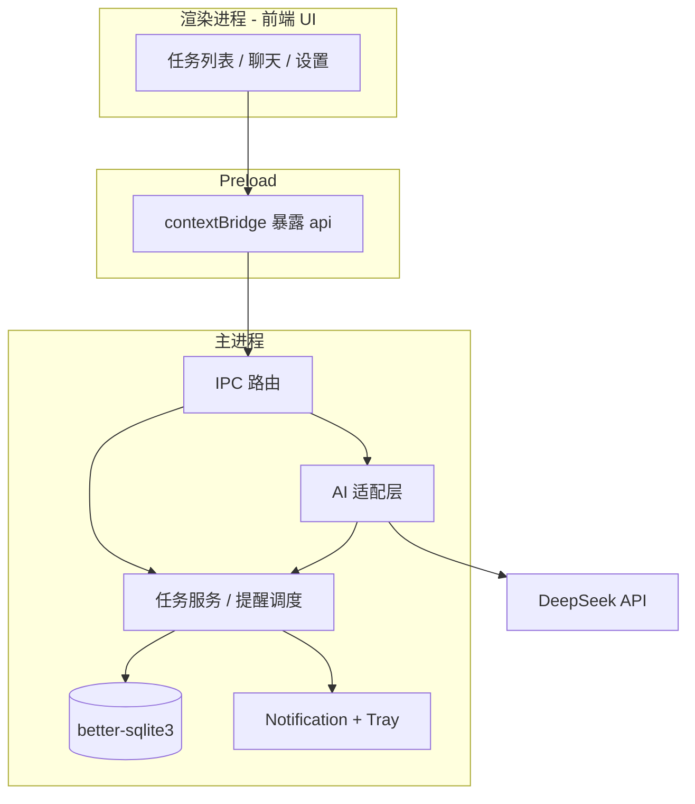

# TodoAI 开发计划书

**技术定案**：Electron + SQLite（桌面客户端，系统通知到位，数据与 API Key 留在本机）

**版本**：v2.0 | **取向**：极简 MVP

---

## 1. 项目定位

**一句话**：个人事务记事本 + 可对话的 AI 助手，负责拆任务、排优先级、**系统级到期提醒**；功能完整但实现尽量少。

**选型理由（相对本地 Web）**

| 需求 | Electron 做法 |
|------|----------------|
| 不依赖打开浏览器 | 独立窗口 + 托盘，可开机自启（可选） |
| 通知到位 | 主进程 `Notification` / 托盘气泡，**窗口关闭/最小化仍可提醒**（应用常驻后台） |
| 隐私 | SQLite 在用户数据目录；DeepSeek 请求仅在**主进程**发出 |

**不做的事（控制范围）**

- 多用户、团队协作、复杂权限
- 与 Outlook/Notion 等深度同步（二期）
- 自研大模型，仅调用 OpenAI 兼容 API（默认 DeepSeek）
- 移动版 App（本计划仅 Windows 优先，macOS 打包次之）

---

## 2. 目标用户与核心场景

| 场景 | 用户行为 | 系统响应 |
|------|----------|----------|
| 随手记 | 输入「下周交报告」 | 解析截止时间，生成待办 |
| 对话规划 | 「这周事情太多，帮我排一下」 | AI 读未完成任务，给优先级与日程建议 |
| **到点提醒** | 无需打开窗口 | **系统通知** + 点击通知聚焦应用 |
| 每日早晨 | 固定时间（可关） | 通知今日清单；可选 AI 简报 |
| 主动安排 | 「让助手规划」 | AI 出建议卡片，**确认后**才写入数据库 |

**原则**：AI「主动」= **建议 + 一键确认**，禁止静默改库。

---

## 3. 技术架构（Electron + SQLite）

### 3.1 分层



| 层级 | 技术 | 职责 |
|------|------|------|
| 渲染进程 | **React + Vite**（或 Vue，二选一定后不改） | 界面、表单、聊天展示 |
| Preload | TypeScript | `window.todoApi.*`，禁止渲染进程直接访问 Node |
| 主进程 | **Electron + TypeScript** | SQLite、定时提醒、AI HTTP、托盘 |
| 数据库 | **better-sqlite3** | 同步 API，适合主进程单写 |
| 打包 | **electron-builder** | Windows `.exe` 安装包 |

**安全基线（必须）**

- `contextIsolation: true`，`nodeIntegration: false`
- API Key 只存在于主进程 / `settings` 表，不传入 DevTools 可见的全局变量
- 外部链接用 `shell.openExternal`

### 3.2 IPC 接口（MVP 清单）

渲染进程只通过以下通道访问能力（先设计接口，实现时保持一致）：

| 通道 | 说明 |
|------|------|
| `tasks:list` / `create` / `update` / `delete` / `complete` | CRUD |
| `settings:get` / `set` | 含 API Key（返回时 UI 可打码） |
| `ai:chat` | 流式可选；MVP 可先整段返回 |
| `ai:suggestSchedule` | 返回 JSON，不写库 |
| `schedule:apply` | 用户确认后的批量更新 |
| `reminder:snooze` | 延后提醒（可选） |

事件（主 → 渲染）：`tasks:changed`、`notification:clicked`（携带 taskId）。

### 3.3 提醒子系统（产品重点）

| 能力 | 实现要点 |
|------|----------|
| 截止前提醒 | 主进程每 **60s** 扫库 + 启动时全量校正；`due_at - reminder_minutes` |
| 系统通知 | `new Notification({ title, body })`；点击 `mainWindow.show()` |
| 托盘 | 关闭窗口 **最小化到托盘**（不退出），保证调度器运行 |
| 每日简报 | `daily_brief_hour` 触发；失败则通知纯任务列表 |
| 去重 | 内存 `Set<taskId+slot>` 或表字段 `last_notified_at`，避免重复弹窗 |

**验收**：应用在托盘、主窗口未打开时，仍能弹出 Windows 通知。

### 3.4 AI 适配层（主进程）

- HTTP：OpenAI 兼容 `POST /v1/chat/completions`（DeepSeek）
- Tools：`list_tasks`、`create_task`、`update_task`、`complete_task`、`get_task`
- 执行工具 → 写 SQLite → 把结果作为 tool message 续聊
- `suggest_schedule`：**不注册为自动工具**，单独接口，仅返回 JSON 供 UI 确认

---

## 4. 极简功能清单（MVP）

### 4.1 待办

- 字段：标题、备注、截止时间、优先级（0/1/2）、状态（open/done）
- 视图：全部 / 今日 / 逾期 / 已完成
- 离线可用（不依赖 AI）

### 4.2 AI 助手

- 侧边栏对话 + 当前任务摘要（≤30 条 open）
- 工具改库后列表自动刷新
- 设置页：Base URL、Key、模型名、时区

### 4.3 提醒（MVP 必做，非可选）

- 系统通知 + 应用内列表高亮（打开窗口时）
- 设置：提前 N 分钟、每日简报时刻、开关

### 4.4 延后

- 语音、附件、标签、重复任务、月历、云同步、开机自启（可放在 M5 后小版本）

---

## 5. 数据模型

**库文件位置**：`app.getPath('userData')/todo.db`（勿放仓库目录）

**tasks**

| 字段 | 类型 | 说明 |
|------|------|------|
| id | TEXT | UUID |
| title | TEXT | 必填 |
| note | TEXT | |
| due_at | TEXT NULL | ISO8601 本地语义 |
| priority | INTEGER | 0低 1中 2高 |
| status | TEXT | `open` \| `done` |
| last_notified_at | TEXT NULL | 提醒去重 |
| created_at / updated_at | TEXT | |

**settings**（key-value）

| key 示例 | 说明 |
|----------|------|
| deepseek_api_key | 加密存储（MVP 可明文本地，v1.1 用 safeStorage） |
| deepseek_base_url | 默认 `https://api.deepseek.com` |
| deepseek_model | 默认 `deepseek-chat` |
| reminder_minutes_before | 默认 30 |
| daily_brief_enabled | 0/1 |
| daily_brief_hour | 0–23 |
| timezone | 如 `Asia/Shanghai` |

**chat_messages**（可选）

- MVP 可仅内存保留 20 轮；要历史记录再建表。

**迁移**：主进程启动执行 `PRAGMA user_version` + 递增 SQL 脚本（单文件 `migrations/`）。

---

## 6. AI 交互设计

### 6.1 System Prompt 要点

- 不编造任务状态；时间用用户 `timezone`
- 除对话解释外，改库必须走 tools
- 规划类输出用 `suggest_schedule` 结构，等用户确认

### 6.2 规划确认流

```
UI: 「让助手规划」
 → main: suggestSchedule(open tasks)
 → 返回 { ordered_ids, notes, proposed_changes[] }
 → UI 卡片勾选
 → main: schedule.apply(approved)
```

### 6.3 Token

- 摘要行：`[priority] title (due)`
- 详情用 `get_task(id)`

---

## 7. 工程结构

```
TodoAI/
├── package.json                 # workspace 或单包
├── electron/
│   ├── main.ts                  # 入口、窗口、托盘、调度器
│   ├── preload.ts
│   ├── ipc/                     # handlers
│   ├── db/
│   │   ├── schema.sql
│   │   ├── migrations/
│   │   └── tasks-repo.ts
│   ├── services/
│   │   ├── reminder-service.ts
│   │   └── ai/
│   │       ├── client.ts
│   │       ├── tools.ts
│   │       └── prompts.ts
│   └── tray.ts
├── src/                         # 渲染进程（Vite root）
│   ├── App.tsx
│   ├── pages/                   # Tasks, Chat, Settings
│   ├── components/
│   └── hooks/
├── shared/                      # 前后端共用类型
│   └── types.ts
├── resources/                   # 图标 .ico
├── docs/
│   └── 开发计划书.md
├── .env.example                 # 仅开发期备用；正式以 settings 为准
└── README.md
```

**推荐脚手架**：`electron-vite` 或 `forge + vite`，**一次选定**，避免混用。

---

## 8. 里程碑与交付

| 阶段 | 交付物 | 预估 |
|------|--------|------|
| **M0** | Electron 空壳 + React UI + SQLite 建表 + `tasks` IPC CRUD | 3 天 |
| **M1** | 任务列表 UI（筛选、编辑、完成） | 3 天 |
| **M2** | 托盘 + **关闭隐藏到托盘** + `Notification` 联调 | 2 天 |
| **M3** | `reminder-service` 扫描 + 去重 + 点击通知聚焦 | 2 天 |
| **M4** | DeepSeek 对话 + 4 工具 + 设置页 | 4–5 天 |
| **M5** | 规划建议 UI + `schedule.apply` | 2–3 天 |
| **M6** | 每日简报 + electron-builder Win 安装包 | 2–3 天 |

**合计**：约 **3–4 周**（业余）。通知链路（M2–M3）建议紧接 M1，避免后期返工。

---

## 9. 验收标准（MVP Done）

1. 无网络可完整管理任务；有 Key 可对话并让 AI 通过 tools 改任务  
2. **主窗口未打开、进程在托盘时**，到点仍出现系统通知，点击可打开并定位任务  
3. 规划类操作必须经确认卡片，拒绝未确认的批量改期  
4. 卸载/reinstall 不丢数据（数据在 userData）  
5. Base URL 可切换至其他 OpenAI 兼容服务  

---

## 10. 安全与发布

- `.gitignore`：`node_modules`、`dist`、`*.db`、`.env`
- 日志不写完整 Key；错误信息对用户友好
- 开发依赖 `electron-reload` 可选；生产关闭 DevTools 自动打开
- 代码签名：个人阶段可跳过；文档注明 SmartScreen 提示

---

## 11. 风险与对策

| 风险 | 对策 |
|------|------|
| 用户点 X 以为退出，实际应驻托盘 | 首次启动提示；设置里「退出」与「隐藏」分开 |
| Windows 专注助手屏蔽通知 | 文档说明；应用内「今日待办」兜底 |
| better-sqlite3 原生模块打包 | 使用 electron-builder 配置的 rebuild / 指定 ABI |
| 模型误操作 | tools + 规划确认；高风险批量更新需二次确认 |
| API 费用 | 摘要上下文；简报每日上限 1 次 |

---

## 12. 开工顺序（执行清单）

1. **M0**：`electron-vite` 初始化 → `shared/types` → `schema.sql` → IPC CRUD 跑通  
2. **M1**：任务 UI 对接 IPC（无 AI）  
3. **M2–M3**：托盘 + 提醒（早于 AI，满足你的核心偏好）  
4. **M4–M5**：DeepSeek + 规划确认  
5. **M6**：简报 + 安装包 + README 运行说明  

**下一步（代码）**：执行 M0 脚手架与数据库，并在 README 写入 `npm run dev` / `npm run build`。

---

*定案：Electron + SQLite | 通知为主进程职责 | 后续变更请升版本号并记录于本节末尾。*

**变更记录**

- v2.0：确定 Electron + SQLite；补充 IPC、提醒、托盘、目录与里程碑 M0–M6
- v2.1：完成 M6（每日简报 `daily_brief_*` 设置 + 主进程调度；`npm run dist` Windows NSIS 安装包）
